# Gazebo Visual and Sensor Follower Architecture

The accepted mode is:

```yaml
simulation:
  physics_backend: internal
gazebo:
  role: visual_sensor_follower
  vehicle_dynamics_authority: false
```

## Authority chain

```mermaid
flowchart LR
  A[Pure Pursuit motion request] --> B[VCU validation]
  B --> C[VCU safety envelope]
  C --> D[Independent safety override]
  D --> E[Steering, brake and motor actuators]
  E --> F[Internal DynamicFourWheelKart]
  F --> G[Frozen authoritative snapshot]
  G --> H[Bounded ROS bridge queue]
  H --> I[Static Gazebo pose and joint follower]
  I --> J[Gazebo rendered sensors]
  J --> K[Timestamp-preserving ROS delivery queues]
```



Gazebo has no command edge back to the VCU or plant. The static model receives
`SetWorldPose` and joint positions only. It never calls `SetForce`, drives a
joint controller, or feeds contact forces into the internal state.

## Components

- `kart_sim.gazebo_follower.AuthoritativeVehicleSnapshot` is frozen and
  validates finite values, normalized orientation angles, monotonic
  sequence/time, reset epoch and configuration hash.
- `AuthoritativeSnapshotFactory` samples only after a completed plant step and
  accumulates rotations from measured wheel and rear-axle speeds.
- `AuthoritativeSnapshotBuffer` is bounded, epoch-aware and interpolation-only;
  it never extrapolates.
- `libautokart_gazebo_follower.so` consumes only
  `/autokart/follower/authoritative_snapshot`.
- The plugin is the sole publisher of `/clock`, dynamic `odom -> base_link`,
  `/joint_states`, `/vehicle/odometry` and follower diagnostics in this mode.
- `libautokart_gazebo_sensor_delivery.so` captures native RGB, depth and ray
  payloads and publishes capture/delivery metadata.
- The internal IMU remains the configured operational source and uses the same
  timestamp/latency contract. A conflicting Gazebo IMU is not published.

## World progression

The follower interpolates at Gazebo's 1 ms steps between 100 Hz immutable
snapshots. This lets render sensors observe time-consistent intermediate poses
without making Gazebo a motion authority. When no next snapshot exists, the
world is paused rather than integrating the last velocity.

The 500 ms wall watchdog distinguishes:

- publisher present: intentional upstream pause, frozen and valid;
- publisher absent: bridge disconnect, frozen and invalid.

Both cases leave simulation timestamps and sensor capture stopped. A new reset
epoch permits an explicit clock rewind, resets pose/joints and flushes sensor
queues. Old epochs cannot resume autonomy or command authority.

## Runtime invariants

Startup rejects a non-static model, any dynamics-authority role, and SDF tokens
for differential drive, Ackermann, `gazebo_ros2_control`, motor, steering or
brake controllers. Pose, orientation, steering, wheel and clock mismatches are
checked against `configs/safety/gazebo_follower_acceptance.yaml`. A violation
pauses the world and publishes an error diagnostic.

This is a visualization and sensor system, not a co-simulation contact model.
Gazebo contacts are deliberately visual-only.
