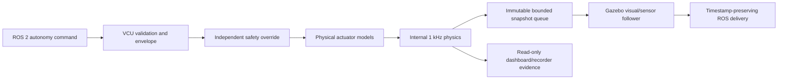

# Real-Time Architecture

The real-time scheduler does not alter the command-authority chain:

The authoritative core runs in a spawned process. Its queue capacity is one,
and data flow is only core to bridge. The bridge cannot return a command,
collision force, joint target, reset request, or fault clear to the plant.

## Scheduler modes

- `deterministic_offline`: no wall-time pacing; no core cycles are skipped.
- `realtime_synchronized`: absolute-time pacing at the configured wall target;
  no safety, VCU, or physics step is skipped when late.
- `step`: deterministic single-step support in `RealTimeSynchronizer`.

Sensor and visualization work may reject frames according to explicit bounded
policies. It may never skip the VCU or independent-safety task.

The workstation profile assigns Gazebo to physical cores 0–3, ROS delivery to
core 4, and the authoritative process to core 5. These CPU lists are profile
specific and must be remeasured on another machine.
